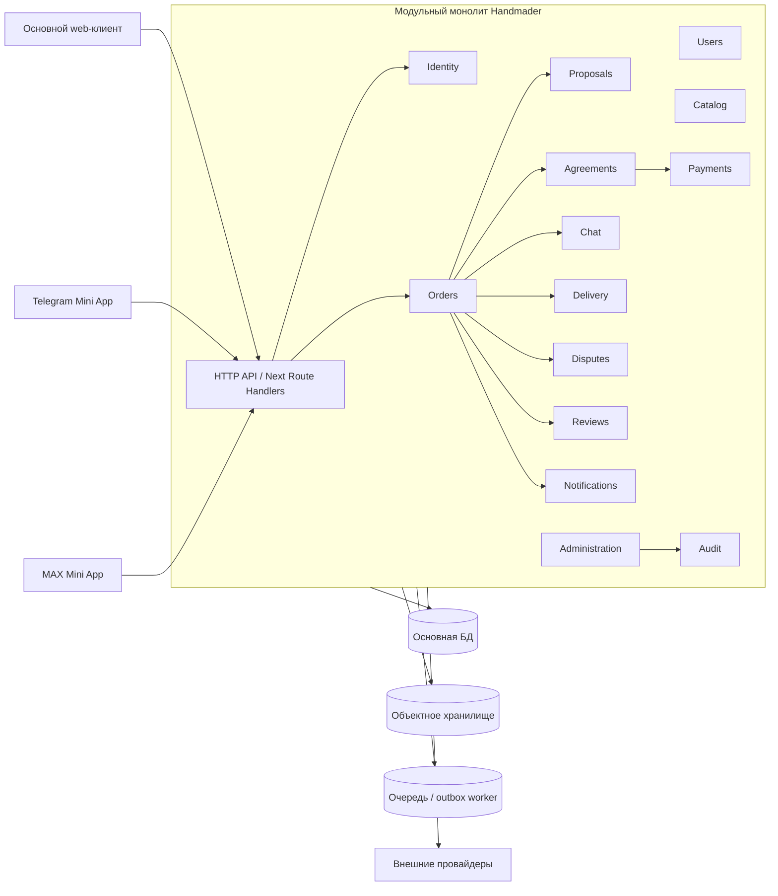

# Архитектура Handmader

Статус: целевая архитектура и правила постепенной миграции текущего прототипа.  
Дата: 26 октября 2026 года.

## Цель

Handmader развивается как модульный монолит: один развёртываемый backend, одна транзакционная граница и набор изолированных бизнес-модулей. Архитектура не требует микросервисов для закрытой беты, но не связывает доменную логику с Firebase, Vercel, Telegram или конкретным платёжным провайдером.

## Контекст



## Модули

| Модуль | Владеет | Не должен делать |
|---|---|---|
| `identity` | аутентификация, проверка внешней сессии, роли | хранить заказы или менять платежи |
| `users` | приватный пользователь, публичный псевдоним, настройки | рассчитывать рейтинг напрямую из UI |
| `catalog` | виды изделий и версии форм мерок | менять снимок старого заказа |
| `orders` | заказ, состояние, участники, временная шкала | обращаться к Telegram напрямую |
| `proposals` | закрытые отклики и их версии | раскрывать предложения конкурентам |
| `agreements` | подтверждённые условия и изменения | перезаписывать принятую версию |
| `staffMembers` | отдельные роли сотрудников и признак активности | смешивать с публичной ролью заказчика/мастера |
| `chat` | сообщения, доступ участников, антиобход | создавать финансовые события |
| `payments` | тестовый ledger, адаптер провайдера, возвраты и выплаты | доверять статусу из браузера |
| `material-advances` | запрос аванса, подтверждение заказчика, расходы и остаток | считать разрешение реальной выплатой мастеру |
| `delivery` | способ передачи, трек, подтверждение | автоматически решать спор |

Первый администратор назначается серверным параметром
`HANDMADER_BOOTSTRAP_ADMIN_UIDS` (список Firebase UID через запятую). После
создания записей `staffMembers` bootstrap-список следует очистить; отключённая
запись сотрудника всегда имеет приоритет над bootstrap-настройкой.
| `disputes` | дело, доказательства, решение | изменять доказательства после фиксации |
| `reviews` | взаимные отзывы и публикация через 7 дней | позволять мастеру удалять отзыв |
| `notifications` | шаблоны, outbox, каналы доставки | принимать готовый системный текст от клиента |
| `administration` | верификация, поддержка, категории, споры | обходить аудит действий |
| `audit` | неизменяемые события критических операций | содержать секреты и лишние персональные данные |

## Структура модуля

```text
modules/<module>/
├── domain/          # чистые правила, сущности, value objects, ошибки
├── application/     # команды, запросы, orchestration, порты
└── infrastructure/  # Firestore/PostgreSQL, Firebase Auth, HTTP, провайдеры
```

Зависимости направлены внутрь:

```text
UI / HTTP → application → domain
                       ↑
                infrastructure
```

Доменный слой:

- не импортирует Firebase, Next.js, React и SDK провайдеров;
- не читает переменные окружения;
- не выполняет сеть и ввод-вывод;
- тестируется обычными unit-тестами.

Межмодульное взаимодействие выполняется через публичные application-команды и доменные события. Прямое изменение чужих коллекций или таблиц запрещено.

## Транзакционная модель

Доверенная команда выполняет в одной транзакции:

1. проверку текущего состояния агрегата;
2. применение доменного правила;
3. изменение агрегата;
4. запись `AuditEvent`;
5. запись событий в outbox или создание системного уведомления;
6. сохранение receipt по `commandId` для идемпотентности.

HTTP-повтор с тем же `commandId` возвращает прежний результат и не повторяет побочные эффекты.

Первый реализованный вертикальный срез — выбор мастера:

```text
Firebase ID token
→ POST /api/orders/{id}/select-master
→ проверка владельца заказа
→ чистое доменное решение
→ Firestore transaction
→ заказ + audit + notification + command receipt
```

Повторный выбор мастера также является доверенной составной командой:

```text
заказчик → обращение reselectionCases
→ сотрудник поддержки проверяет причину
→ атомарное снятие выбранного мастера и закрытие старого чата
→ новый reselectionCycle и 48-часовое подтверждение старых откликов
→ предыдущий исполнитель остаётся в истории, но исключается из выбора
```

Актуальность откликов после повторного открытия определяется номером цикла,
поэтому операция не требует массового переписывания всех предложений. Мастер
подтверждает собственный отклик отдельной идемпотентной серверной командой.

Аванс на материалы моделируется отдельным финансовым агрегатом:

```text
мастер → запрос суммы (не более 50% итоговой цены)
→ заказчик явно подтверждает
→ mock ledger фиксирует разрешение без реального перевода
→ мастер фиксирует расходы и неиспользованный остаток
→ audit + notifications + command receipt на каждом шаге
```

Сами подтверждающие файлы будут добавлены через `ObjectStorage`; до подключения
хранилища сохраняются реквизиты и описание доказательства без base64-вложений.

Передача и приёмка выделены в модуль `delivery`:

```text
подтверждённые условия + готовый заказ
→ мастер фиксирует личную передачу или перевозчика с трек-номером
→ заказчик подтверждает фактическое получение
→ начинается 5-дневное окно приёмки
→ явная приёмка или защищённая автоприёмка без открытого спора
```

Клиент не читает и не меняет `deliveries` напрямую. Каждый шаг выполняется
серверной транзакцией с аудитом, уведомлением и `commandId`. Плановая автоприёмка
защищена `CRON_SECRET`; её включение допустимо только одновременно с контуром споров.

Споры хранятся как отдельные агрегаты `disputes`. Оба участника оплаченного заказа
могут добавлять неизменяемые пояснения и HTTPS-ссылки. Файловые доказательства будут
подключены через `ObjectStorage`. Поддержка может изучать очередь, а итоговое решение с явным
денежным расчётом фиксирует только администратор. Решение не выполняет реальный возврат или выплату:
оно создаёт `refund_pending` или `payout_pending` для следующего тестового финансового шага.

## Текущее и целевое хранилище

### Этап закрытой беты

- Firebase Authentication;
- Cloud Firestore;
- Firebase Storage после миграции фотографий;
- Next.js backend в том же deployment;
- тестовый платёжный адаптер.

Это временные инфраструктурные адаптеры, а не часть доменной модели.

### Переносимый профиль

- PostgreSQL как основная транзакционная БД;
- S3-совместимое объектное хранилище;
- Redis опционально для rate limit, коротких блокировок и очередей;
- outbox worker в том же кодовом репозитории;
- OpenID Connect или собственный адаптер идентификации;
- Docker image, запускаемый в Kubernetes, Docker Compose или обычной VM.

Для российских серверов подходят любые совместимые реализации PostgreSQL и S3. Выбор конкретного хостинга не должен менять доменный или application-слой.

## План замены инфраструктуры

| Текущий компонент | Порт приложения | Возможная замена |
|---|---|---|
| Firebase Auth | `IdentityProvider` | Keycloak, российский OIDC, собственный auth |
| Firestore | репозитории модулей + Unit of Work | PostgreSQL |
| Firebase Storage | `ObjectStorage` | S3/MinIO/российское облако |
| Vercel Functions | HTTP runtime | Docker/VM/Kubernetes |
| Telegram Bot API | `NotificationChannel` | сохраняется как внешний канал |
| будущий MAX API | `NotificationChannel` | отдельный адаптер |
| mock payments | `PaymentProvider` | выбранный банк/касса |

Миграция выполняется адаптер за адаптером. Запрещено создавать общий «универсальный repository» без предметных границ: каждый модуль определяет минимальный собственный порт.

## Развёртывание

Репозиторий собирает standalone Next.js-приложение. Контейнер не хранит состояние на локальном диске и получает конфигурацию через environment variables.

Минимальные группы переменных:

- публичная конфигурация web-клиента Firebase;
- серверная сервисная учётная запись Firebase;
- Telegram/MAX credentials;
- выбранный storage и payment adapter;
- observability и environment name.

Секреты не попадают в `NEXT_PUBLIC_*`, git, image layer или клиентский bundle.

## Правила миграции существующего кода

1. Новые доверенные операции создаются только как серверные команды.
2. Существующая функция из `lib/firestore.ts` переносится вертикальным срезом: домен → server adapter → API → client call.
3. После миграции операции Firestore rules запрещают соответствующую прямую запись клиента.
4. UI не переписывается одновременно без необходимости: меняется его transport boundary.
5. Сначала переносятся P0/P1-сценарии аудита, затем новые функции спецификации.
6. После полного переноса `lib/firestore.ts` остаётся только для разрешённых realtime-чтений либо удаляется.

## Ближайшая последовательность

1. Выбор мастера — серверная транзакция и аудит.
2. Отклик мастера — закрытая серверная команда и отдельная сущность proposal.
3. Переходы `start/ready/delivered/completed` — единая state machine.
4. Чат — проверка участников, атомарное сообщение, последние 50 сообщений.
5. Отзывы — отдельная коллекция, уникальность и отложенная публикация.
6. Публичный/приватный профиль и псевдонимы.
7. Медиа — объектное хранилище вместо base64.
8. Mock payments, agreements, delivery и disputes.
9. Admin UI и роли.
10. Ужесточение Firestore rules после миграции каждого write path.

